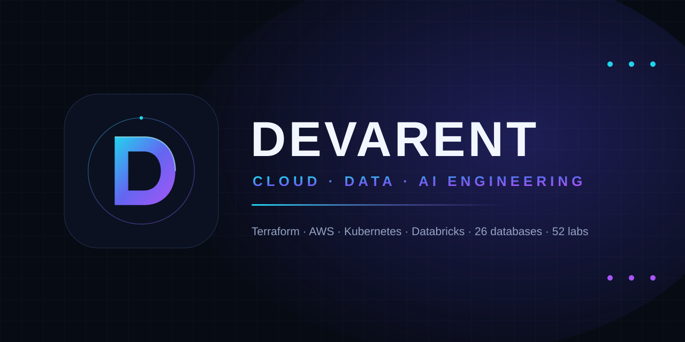
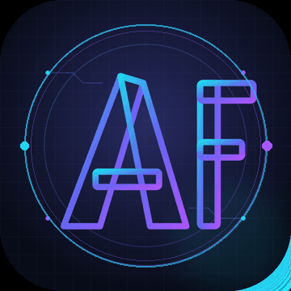

<!-- identity-block -->

<h1>devarent</h1>

<b>AI Engineering · Software, Data &amp; Cloud</b>

 

Engineering portfolio — hands-on labs in DevOps, Backend, QA, and AI, built and documented in the open.

 

📍 Jakarta, Indonesia · they/them · [@devarent](https://github.com/devarent)

  

## 🧭 At a glance

| Field | Detail |
| --- | --- |
| Repository | devarent |
| Primary language | Python, TypeScript, Java, JavaScript, HCL, Shell |
| Topics | profile, portfolio, devops, backend, qa, ai |
| License | MIT |
| Branch | main |
| Maintainer | [@devarent](https://github.com/devarent) |

## 👋 Overview

This is the profile repository for @devarent. It collects the engineering labs, skill matrix, and stack coverage map for 78 public repositories, with a full technology badge wall and a short "Now" section describing current focus.

### Global references

🇮🇸 Iceland &middot; 🇳🇿 New Zealand &middot; 🇨🇭 Switzerland &middot; 🇸🇮 Slovenia &middot; 🇮🇪 Ireland &middot; 🇦🇹 Austria &middot; 🇵🇹 Portugal &middot; 🇸🇬 Singapore &middot; 🇫🇮 Finland

---

<!-- dbx-style-kit -->

 

 

<b>78 hands-on engineering labs - DevOps, Backend, QA, and AI, built and documented in the open.</b>

---
## 👋 Hi, I'm Arya

I build and test software end to end: from a clean API and a tested data model, through a container image and a CI/CD pipeline, to a monitored deployment on Kubernetes. My repositories are hands-on engineering labs — each one has runnable code, automated tests, infrastructure as code, and documentation that explains the trade-offs.

- **DevOps & Cloud:** GitHub Actions, GitLab CI concepts, Terraform, Docker, Kubernetes/EKS, Helm, Prometheus, Grafana, Trivy, AWS (VPC, IAM, EC2, RDS, ECR, Lambda)
- **Backend:** Java 21 + Quarkus, C#/.NET, Node.js, PHP/Laravel, REST APIs, PostgreSQL, MySQL, Redis, Kafka concepts
- **Quality Engineering:** Playwright, API and SQL validation, integration/regression/E2E testing, k6 load testing, test strategy and traceability
- **Data & AI:** Python, PyTorch/TensorFlow, scikit-learn, CNN computer vision, quantum-classical ML experiments, Databricks/Snowflake references
- **Frontend:** TypeScript, React, Next.js, Vue/Nuxt concepts, Tailwind CSS, responsive HTML/CSS

> I document what I build, test what I ship, and keep the feedback loop short.

## 🚀 2026 Flagship Labs

| Project | What it demonstrates | Stack |
| --- | --- | --- |
| **[devops-platform-2026](https://github.com/devarent/devops-platform-2026)** | Production-style AWS platform: VPC/EKS/RDS via Terraform, Helm, Kustomize, GitHub Actions, Prometheus/Grafana, Trivy, SLOs, runbooks, incident response, cost notes. | Terraform · AWS · EKS · Helm · Docker · Prometheus |
| **[backend-service-2026](https://github.com/devarent/backend-service-2026)** | Java 21 + Quarkus order service with PostgreSQL, Flyway, Redis, OpenAPI, validation, problem-detail errors, integration tests, Docker and Kubernetes. | Java · Quarkus · PostgreSQL · Redis · Maven |
| **[qa-automation-2026](https://github.com/devarent/qa-automation-2026)** | Digital-banking QA lab: Playwright E2E + API tests, SQL/data-integrity checks, idempotency and ledger validation, k6 load tests, CI reporting. | Playwright · Node.js · SQL · k6 · GitHub Actions |
| **[hris-itk-laravel](https://github.com/devarent/hris-itk-laravel)** | Full HRIS web application: attendance, performance review, payroll, reporting, role-based access, and a hardened local installer. | Laravel · PHP · MySQL · Tailwind |
| **[aws-ec2-web-hosting-part-1](https://github.com/devarent/aws-ec2-web-hosting-part-1)** | Next.js production deployment lab with PostgreSQL, Docker, Terraform, Kubernetes/Helm, Nginx, and health checks. | Next.js · AWS · Terraform · Docker |
| **[cnn](https://github.com/devarent/cnn)** | CNN animal detection integrated with a camera sensor and a telemetry database. | Python · TensorFlow · PyTorch · OpenCV |

## 🗃️ Database Labs (2026)

**26 database engines, one index.** [database-labs](https://github.com/devarent/database-labs) maps every lab; [database-labs-demo](https://github.com/devarent/database-labs-demo) is a runnable FastAPI + PostgreSQL 17 app with real writes, seven tests against PostgreSQL, and Render/Fly/VPS deploy configs.

| Family | Labs |
| --- | --- |
| **Relational &amp; distributed SQL** | [Firebird](https://github.com/devarent/firebird-lab), [IBM Db2](https://github.com/devarent/ibm-db2-lab), [MariaDB](https://github.com/devarent/mariadb-practicum), [SQL Server](https://github.com/devarent/sql-server-lab), [CockroachDB](https://github.com/devarent/cockroachdb-lab), [InterSystems IRIS](https://github.com/devarent/intersystems-iris-lab), [JDBC](https://github.com/devarent/jdbc-lab) |
| **Cloud &amp; analytics** | [Databricks SQL](https://github.com/devarent/databricks-sql-lab), [Snowflake](https://github.com/devarent/snowflake-lab), [Amazon Redshift](https://github.com/devarent/redshift-lab), [Google BigQuery](https://github.com/devarent/bigquery-lab), [Teradata](https://github.com/devarent/teradata-lab), [Vertica](https://github.com/devarent/vertica-lab), [Databend](https://github.com/devarent/databend-lab), [Apache Kylin](https://github.com/devarent/apache-kylin-lab) |
| **NoSQL &amp; search** | [Redis](https://github.com/devarent/redis-lab), [MongoDB](https://github.com/devarent/mongodb-practicum), [Apache Cassandra](https://github.com/devarent/cassandra-lab), [Elasticsearch](https://github.com/devarent/elasticsearch-lab) |
| **Vector &amp; graph** | [Qdrant](https://github.com/devarent/qdrant-lab), [ChromaDB](https://github.com/devarent/chromadb-lab), [Neo4j](https://github.com/devarent/neo4j-lab) |
| **Streaming &amp; time-series** | [Apache Kafka](https://github.com/devarent/apache-kafka-lab), [VictoriaMetrics](https://github.com/devarent/victoriametrics-lab), [InfluxDB](https://github.com/devarent/influxdb-lab), [TDengine](https://github.com/devarent/tdengine-lab) |

Every Docker lab binds its ports to `127.0.0.1` and ships with the shared [remote-access guide](https://github.com/devarent/database-labs/blob/main/REMOTE-ACCESS.md): WireGuard/SSH tunnels, managed free tiers, and a hardened public HTTP demo pattern.

## 🧠 Skill Matrix

| Area | Working knowledge |
| --- | --- |
| **CI/CD & automation** | GitHub Actions, GitLab CI/Jenkins concepts, build/test/deploy pipelines, release tagging, GHCR, artifact and test reporting |
| **Cloud** | AWS VPC, subnets, route tables, NAT/IGW, security groups, IAM/IRSA, EC2, ECR, EKS, RDS, Lambda, S3; Alibaba Cloud/GCP fundamentals |
| **Containers & orchestration** | Docker multi-stage builds, non-root images, Compose, Kubernetes Deployments/Services/Ingress/HPA/PDB/NetworkPolicy, Helm, Kustomize |
| **Infrastructure as Code** | Terraform modules, remote-state pattern, variables/validation, `fmt`/`validate`, Ansible fundamentals |
| **Observability** | Prometheus metrics and alert rules, Grafana dashboards, health/readiness probes, SLO/error-budget thinking, structured logs, ELK/OpenSearch concepts |
| **DevSecOps** | Trivy image/config scanning, dependency review, secret hygiene, least-privilege IAM, Kubernetes security contexts, SBOM generation |
| **Backend & data** | REST/JSON/HTTP, OpenAPI, Java/Quarkus, C#/.NET, Node.js, Laravel, PostgreSQL, MySQL, Redis, Kafka/NATS concepts, SQL tuning and constraints |
| **Quality engineering** | Test strategy/plan/cases, STLC/SDLC, Playwright, API contract checks, SQL validation, regression/E2E, k6, defect reporting, traceability |
| **AI & data engineering** | Python, pandas, scikit-learn, PyTorch/TensorFlow, CNN vision, LLM integration concepts, AI-assisted SDLC, Databricks/Snowflake reference work |

## 🧩 Stack Coverage

Every technology below has a hands-on repository. This is a map of where to find working code, not a list of claims.

| Stack | Repository | What it shows |
| --- | --- | --- |
| Terraform | [devops-platform-2026](https://github.com/devarent/devops-platform-2026), [terraform-databricks-sra-modernized](https://github.com/devarent/terraform-databricks-sra-modernized) | VPC/EKS/RDS modules, remote state, validation; Databricks SRA reference |
| Kubernetes | [k8s](https://github.com/devarent/k8s), [devops-platform-2026](https://github.com/devarent/devops-platform-2026) | Deployments, Services, Ingress, HPA, PDB, NetworkPolicy, Helm chart |
| Docker | [nextjs-aws-production](https://github.com/devarent/nextjs-aws-production), [backend-service-2026](https://github.com/devarent/backend-service-2026) | Multi-stage builds, non-root images, Compose for local stacks |
| HTML / CSS | [arya123](https://github.com/devarent/arya123) | Responsive portfolio and web pages |
| JavaScript / TypeScript | [arya123](https://github.com/devarent/arya123), [unit-testing-practice](https://github.com/devarent/unit-testing-practice), [qa-automation-2026](https://github.com/devarent/qa-automation-2026) | Web UI, Node unit testing, Playwright automation |
| Laravel / PHP | [hris-itk-laravel](https://github.com/devarent/hris-itk-laravel), [laravel-modernized](https://github.com/devarent/laravel-modernized) | Full HRIS application; framework reference mirror |
| MySQL | [hris-itk-laravel](https://github.com/devarent/hris-itk-laravel), [mariadb-practicum](https://github.com/devarent/mariadb-practicum) | Schema, migrations, queries, indexes, transactions |
| MongoDB | [mongodb-practicum](https://github.com/devarent/mongodb-practicum) | Document modeling, aggregation pipeline, indexes, CRUD |
| MariaDB | [mariadb-practicum](https://github.com/devarent/mariadb-practicum) | SQL design, procedures, triggers, backup and replication notes |
| PostgreSQL | [backend-service-2026](https://github.com/devarent/backend-service-2026), [aws-rds](https://github.com/devarent/aws-rds) | Flyway migrations, constraints, RDS configuration |
| Databricks / Snowflake | [snowflake-databricks](https://github.com/devarent/snowflake-databricks), [devhub-modernized](https://github.com/devarent/devhub-modernized) | Integration notes and developer reference |
| AWS | [aws-ec2-web-hosting-part-1](https://github.com/devarent/aws-ec2-web-hosting-part-1), [aws-rds](https://github.com/devarent/aws-rds), [lambda-localstack-lab](https://github.com/devarent/lambda-localstack-lab) | EC2, RDS, Lambda, VPC/IAM, CI/CD |

## 🔬 Selected Work

| Project | Description | Stack |
| --- | --- | --- |
| [Quantum Hybrid Resornizations](https://github.com/devarent/quantum-hybrid-ml-databricks-snowflake) | Hybrid quantum/classical machine learning with Databricks and Snowflake integration. | Python · PyTorch · Quantum ML |
| [Quantum Hybrid Diffusion Models](https://github.com/devarent/quantum-hybrid-diffusion-models) | Quantum-enhanced generative diffusion experiments. | Python · Jupyter · Quantum ML |
| [UTS EC2 Amazon Linux](https://github.com/devarent/uts-ec2-amazon-linux) | Full cloud deployment lab: EC2, Docker, Terraform, Helm, and CI/CD. | AWS · Docker · Helm · Actions |
| [Credit Card Fraud Detection](https://github.com/devarent/credit-card-fraud) | Fraud classification with imbalanced-dataset handling. | Python · scikit-learn · Jupyter |
| [Email Spam Detector](https://github.com/devarent/email-spam-detector) | NLP pipeline for spam classification. | Python · NLP · scikit-learn |
| [Kubernetes Manifests](https://github.com/devarent/k8s) | Deployment manifests for HRIS, Laravel, and workspace services. | Kubernetes · YAML · DevOps |

## 📚 Engineering References

Carefully credited mirrors used to study established open-source systems. Upstream authors retain ownership; each repository links to its source and license.

| Area | Repository |
| --- | --- |
| UI components | [shadcn/ui reference](https://github.com/devarent/ui-modernized) |
| Frontend library | [React reference](https://github.com/devarent/react-modernized) |
| Developer documentation | [Databricks DevHub reference](https://github.com/devarent/devhub-modernized) |
| Cloud security | [Databricks Terraform SRA reference](https://github.com/devarent/terraform-databricks-sra-modernized) |
| PHP framework | [Laravel reference](https://github.com/devarent/laravel-modernized) |
| Streaming ingestion | [Zerobus SDK reference](https://github.com/devarent/zerobus-sdk-modernized) |

### Databricks ecosystem (upstream links)

These are the upstream projects I study and use as references; they are linked, not forked, so credit and release history stay with the authors.

| Project | Why it matters |
| --- | --- |
| [databricks-sdk-py](https://github.com/databricks/databricks-sdk-py) | Python SDK for workspace, jobs, clusters, and Unity Catalog automation |
| [databricks-cli](https://github.com/databricks/cli) | CI/CD-friendly command line for bundles and workspace operations |
| [terraform-provider-databricks](https://github.com/databricks/terraform-provider-databricks) | Infrastructure as code for Databricks resources |
| [mlops-stacks](https://github.com/databricks/mlops-stacks) | Production ML project template with CI/CD and testing |
| [dbt-databricks](https://github.com/databricks/dbt-databricks) | Analytics engineering on the lakehouse |
| [databricks-sql-python](https://github.com/databricks/databricks-sql-python) | SQL connector patterns for Python services |
| [bundle-examples](https://github.com/databricks/bundle-examples) | Databricks Asset Bundle patterns for deployment |
| [terraform-databricks-sra](https://github.com/databricks/terraform-databricks-sra) | Security reference architecture for regulated environments |

## ⚡ Now

> What I'm focused on right now: keeping the 2026 labs runnable and tested, studying how [DBX](https://github.com/t8y2/dbx) ships a 25 MB Rust + Tauri desktop app (my fork lives at [devarent/dbx](https://github.com/devarent/dbx)), and tightening Kubernetes, Terraform, SQL, and Playwright fundamentals — in the open, one repo at a time.

## 📊 GitHub Activity

## 🔎 Explore

[Browse all repositories](https://github.com/devarent?tab=repositories) · [Role fit](ROLE-FIT.md) · [Profile](https://github.com/devarent) · [Issues and requests](https://github.com/devarent/devarent/issues)

Built with care. Documented in the open. Feedback is welcome.

---

## Project Governance

[Contributing](CONTRIBUTING.md) · [Security Policy](SECURITY.md) · [Code of Conduct](CODE_OF_CONDUCT.md)

---

<!-- dbx-connections -->

🔌 <b>DBX Connections</b> — 23 decorative reference badges (klik untuk buka)

 

Connection names shown in the DBX sidebar — decorative reference badges.

---

<!-- tech-stack-wall -->

🛠️ <b>Full Tech Stack Wall</b> — languages, frontend, databases, streaming, DevOps &amp; tooling (klik untuk buka)

 

<b>Languages</b> 

  
<b>Frontend &amp; Desktop</b> 

  
<b>Database &amp; Storage</b> 

  
<b>Messaging &amp; Streaming</b> 

  
<b>DevOps &amp; Cloud Native</b> 

  
<b>Tools &amp; Platforms</b> 

Hands-on engineering, built and documented in the open.

---

<!-- Salin blok ini ke bagian atas/bawah README repo profil devarent/devarent. -->

  

  

## 🚀 Devarent — Cloud & Data Control Center

Seluruh repository dipetakan ke **9 konstelasi bertema negara**, lalu disambungkan ke **26 teknologi data** dan toolchain cloud: Terraform, AWS EC2 + Elastic IP, Docker, Kubernetes/Helm, GitHub Actions, Databricks, dan Keras.

| Konstelasi | Fokus | Contoh |
| --- | --- | --- |
| 🇮🇸 Aurora | Frontier AI & Quantum | Aurora Diffusion, Obsidian Guard |
| 🇳🇿 Kiwi | Web & Product | Kauri HRIS, Pohutukawa Web |
| 🇨🇭 Alpine | Cloud & DevOps | Summit Platform, Matterhorn Host |
| 🇸🇮 Dragon | Backend & Data Bridge | Dragon Order, Triglav Bridge |
| 🇮🇪 Clover | Quality & Testing | Clover Unit, Shamrock Flow |
| 🇦🇹 Danube | Data & Learning | Waltz Pipeline, Edelweiss SQL |
| 🇵🇹 Azulejo | Reference Mirrors | Lisbon SRA, Estoril Zerobus |
| 🇸🇬 Merlion | Platform & Ops | Lion Profile, Hawker Scripts |
| 🇫🇮 Sisu | Systems & Practicum | Birch Assembly, Reindeer IoT |

### 26 teknologi data

- **Relational & distributed SQL:** Firebird, IBM Db2, MariaDB, SQL Server, CockroachDB, InterSystems IRIS, JDBC
- **Cloud & analytics:** Databricks SQL, Snowflake, Redshift, BigQuery, Teradata, Vertica, Databend, Apache Kylin
- **NoSQL & search:** Redis, MongoDB, Cassandra, Elasticsearch
- **Vector & graph:** Qdrant, ChromaDB, Neo4j
- **Streaming & time-series:** Kafka, VictoriaMetrics, InfluxDB, TDengine

### Pipeline andal

`WSL 2 Ubuntu` → `aws login / IAM` → `Terraform (EC2 + EIP)` → `Docker build` → `GHCR/ECR` → `GitHub Actions` → `SSH/SSM ke EC2` → `healthcheck + rollback` → `Prometheus/Grafana`.

> Semua kredensial disimpan di GitHub Secrets / AWS IAM. Tidak ada Access Key yang di-commit. IP publik dibaca dari `terraform output -raw public_ip`, bukan `localhost`.

Dashboard interaktif (Next.js + Tailwind + shadcn/Radix) ada di workspace lokal: `repo-atlas-next`. Jalankan dengan `npm run dev` lalu buka `http://localhost:3100`.

---

Dibangun dan didokumentasikan di terbuka oleh **Arya Fatthurahman** · [github.com/devarent](https://github.com/devarent)
